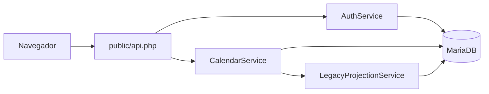

# Calendário acadêmico

Gestão de disciplinas, datas e capacidade de unidades em um calendário administrativo.

**PHP 8.3 · MariaDB · PDO · JavaScript · HTML · CSS**

## O problema

Manter datas e vagas em planilhas dificulta visualizar alterações e preservar a consistência de um sistema de agendamento. O projeto concentra essa manutenção em uma interface mensal com regras de acesso e histórico.

## Funcionalidades do código de integração

- Calendário mensal por cidade e polo, com catálogo de disciplinas.
- Inclusão e remoção de atividades; feriados, bloqueios e exceções de vagas.
- Perfis de leitor, editor e administrador.
- Consultas preparadas, transações, proteção CSRF e histórico de alterações.
- Sincronização com tabelas legadas e verificação de versão antes de salvar.

## Experimente sem banco de dados

Na raiz deste repositório, execute:

```powershell
py -3 -m http.server 8080 --bind 127.0.0.1
```

Abra http://127.0.0.1:8080/demo/ . A demonstração entra automaticamente com um usuário fictício. Selecione uma atividade e clique em **+**; use o botão direito para alterar vagas ou bloquear datas. Clique em **Salvar alterações** e recarregue para verificar a persistência na sessão. Use **Restaurar demonstração** para reiniciar.

**A demonstração é uma simulação em JavaScript.** Ela não executa autenticação real, consultas SQL, transações ou a integração PHP. Os dados ficam em `sessionStorage`. O backend original sanitizado está em `src/`, `public/` e `bin/`.

## Arquitetura da integração



## Decisões técnicas

- Manter o backend em PHP/PDO para integrar com um ambiente existente.
- Concentrar regras em serviços, separando API, autenticação e projeção do legado.
- Rejeitar salvamentos baseados em versões antigas para reduzir sobrescritas concorrentes.
- Registrar mudanças e exigir motivo para alterações administrativas de datas passadas.

## Executar o backend

A integração completa depende de um esquema legado que não é distribuído neste repositório. Consulte [o contrato de integração](docs/INTEGRACAO.md). Os SQLs publicados são referência estrutural, **não constituem uma instalação autônoma**. Para avaliar o projeto sem esse ambiente, utilize a demonstração.

## Verificação

```powershell
./verificar.ps1
```

Requer PHP 8.3 e Node.js no PATH. Verifica sintaxe PHP e testa a simulação. Não substitui testes de integração com MariaDB.

## Autoria

Projeto pessoal de Nicolas Vieira, desenvolvido com apoio de IA. Esta edição pública preserva o código selecionado e acrescenta uma demonstração isolada. Não inclui configurações locais, dados reais, dumps ou migrações específicas de cadastros reais.
